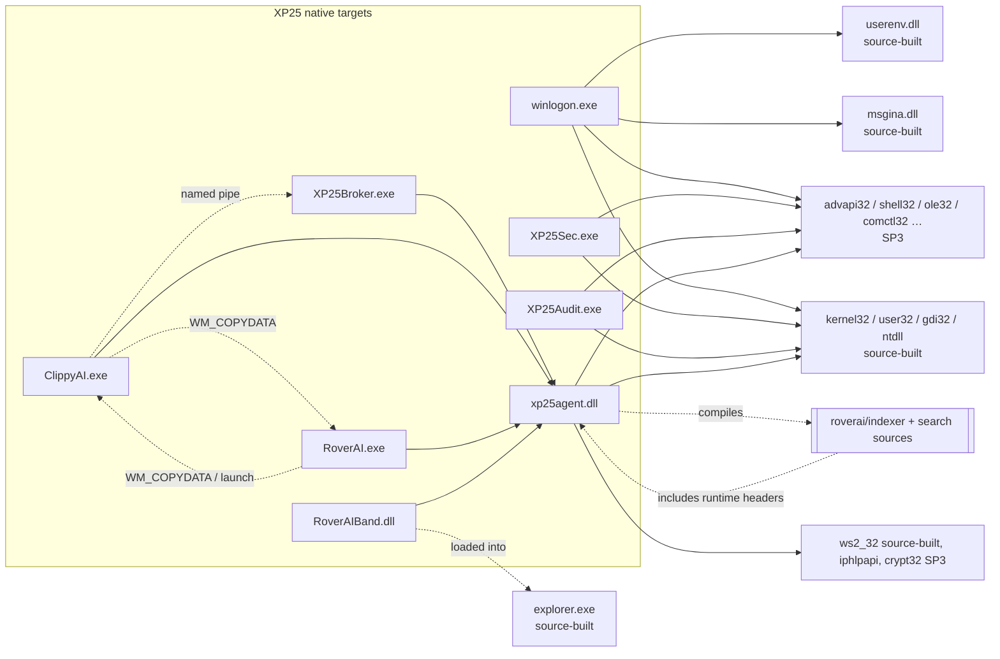

# Architecture and modernization audit (Milestone 8.4)

Worktree `xp25-modernization` (branch `xp25-modernization`), created from
`a77550aa6`: the accepted security line (Milestone 8 → 8.1 → 8.2) plus the
Winlogon account-switch fix. There was no Milestone 8.3; its deferred CVE items
remain deferred. Evidence root `.work/modernization-20261118/` (`M`).
Companion documents: [static analysis](static-analysis-findings.md),
[optimization](optimization-opportunities.md), [roadmap](modernization-roadmap.md).

## Baseline

| Item | Value |
| --- | --- |
| Starting commit | `a77550aa6d26b762efc90b6d51eba8c67c3fa527` |
| Reference tree `Source/XPSP1/NT` | 277,863 files, 6,322,952,743 bytes, manifest `9ff55c73…a151`; re-hashed in this worktree (`M/source-inventory-01`), **unchanged** |
| Tracked files outside `Source/` | 378, manifest `9e7224ea8e0781d7565e10e2043a55ac1c108c12c839f8f59285ce79c2402e89` (`M/inventory-01/inventory.json`) |
| Accepted image used | `XP25-CVE-Hardened-8.2.qcow2` `5a84781f…eada` (reflink copy, hash verified, read-only); not modified |
| Native build VM | `build-vm-ai/disk.qcow2` `c2194f6d…37b7` (frozen) |

The inventory (`build/modernization_inventory.py`) reads only tracked files.
It does not try to load the tree into one context: it extracts targets,
link and include edges, function sizes and complexity, API use and duplicate
windows, and the audit then reads the flagged code.

## What XP25 builds and what it ships

**Built from XP25's own sources** (`components/`, 126 C files with tests):

| Component | Lines (C) | Built by | Installed as | Privilege / exposure |
| --- | --- | --- | --- | --- |
| Winlogon (`components/winlogon`) | 2,331 | NT toolchain (`winlogon.exe`) | `system32\winlogon.exe` | SYSTEM; hosts MSGINA, creates every session |
| Security tools (`components/security`) | 4,063 | NT toolchain (`XP25Sec.exe`, `XP25Audit.exe`) | `Program Files\XP25\Security` | Run by administrators; apply/verify/rollback the baseline |
| Agent runtime, LLM client, policy, tools, IPC (`components/xp25-agent`) | 7,595 | NT toolchain (`xp25agent.dll`) | `Program Files\XP25` | Loaded by ClippyAI, RoverAI, the Explorer bar and the broker; parses network and model data |
| XP25Broker (`components/xp25-agent/broker`) | (in the above) | NT toolchain | Service, LocalSystem | Named pipe served to every interactive user |
| RoverAI (`components/roverai`) | 3,973 | NT toolchain (`RoverAI.exe`, `RoverAIBand.dll`; indexer/search compiled into `xp25agent.dll`) | `Program Files\XP25`, Explorer bar in `explorer.exe` | User; indexes the whole drive |
| ClippyAI (`components/clippyai`) | 1,851 | NT toolchain | `Program Files\XP25` | User; runs approved tools |
| Browser compatibility (`components/browser`) | 348 | MinGW (`pwrp_k32.dll` proxy, `browserctl.exe`) | Supermium directory | In the browser process |
| XP25 Help (`components/help`) | 53 | MinGW | `Program Files\XP25` | User |
| CVE patches (`components/cve`) | 3 patches | Applied to copies of Microsoft source | `lsasrv.dll` (MS04-011) | SYSTEM |

Build-time adapters of Microsoft source also exist: `build/apply_boot_compat.py`,
`apply_pointer_compat.py`, `userenv_sp3_compat.py` and the kernel-export relink.
They were reviewed in their own milestones and not re-audited here.

**Built by the project from Microsoft's 5.1.2600.1106 source** (Milestone 8
audit): 25 binaries — `xp25krnl.exe`, `xp25hal.dll`, `win32k.sys`, `csrss.exe`,
`csrsrv.dll`, `basesrv.dll`, `winsrv.dll`, `ntdll.dll`, `kernel32.dll`,
`user32.dll`, `gdi32.dll`, `imm32.dll`, `lsasrv.dll`, `secur32.dll`,
`services.exe`, `smss.exe`, `msgina.dll`, `userenv.dll`, `regsvc.dll`,
`ws2_32.dll`, `ws2help.dll`, `wshtcpip.dll`, `framebuf.dll`, `mountmgr.sys`,
`xp25ntfs.sys` — plus `explorer.exe`. All are **checked (debug) builds without
`/GS` or SafeSEH**.

**Binary-only**: the remaining ~1,950 PE files are Microsoft SP3 (883) or RTM
(416) binaries, plus bundled programs (Supermium, Microsoft Agent). They are
preserved, not modified.

## Dependency graph

Native targets, their import libraries and the XP25 libraries and source
directories they compile (`M/inventory-01/graph.dot`). System DLLs are
grouped.

Observations:

* **One component cycle.** `xp25agent.dll` compiles RoverAI's indexer and search
  sources, and RoverAI's sources include the agent runtime headers. The shared
  runtime therefore carries one product's search engine, and every agent client
  (including the SYSTEM broker) maps it. Recommendation: roadmap R-8 (a
  `roverengine` static library linked into `xp25agent.dll`, so ownership is
  explicit without changing exports).
* Winlogon is isolated: it links no XP25 library and talks to the rest of XP25
  only through Windows (sessions, notifications).
* The security tools share `sec_core` (portable) and `sec_win` (native) as
  separate compilation units, the same layering as Winlogon.
* There are two inter-process channels into privileged code: the broker's pipe
  (SYSTEM) and Winlogon's MSGINA dispatch. Both are covered by earlier
  milestones' tests and by this audit's review.

## Interfaces and ABI

* XP25's native C code is compiled with the NT build's default `/Gz`
  (`MSC_CALL_TYPE` in `tools/i386mk.inc`). Functions exported by `xp25agent.dll`
  without an explicit convention are therefore `__stdcall`, and only callbacks
  handed to the C runtime are marked `XP25_CDECL`. A caller built outside the NT
  tree must declare them `WINAPI`. The Milestone 8.4 benchmark probe first got
  this wrong and crashed (`runs/m84-rover-phases-up-01`, kept).
* Exports are listed by name in `.def` files (`xp25agent.def`, `roverband.def`);
  no export was added, removed or reordered in this milestone.
* Shared structures (`ROVER_SETTINGS`, `XP25W_PATHS`, `XP25_CONFIG`,
  `ROVER_INDEX`, …) contain no 64-bit members except `ROVER_ENTRY.size`, so
  their layout does not depend on the compiler's `long long` alignment. None
  changed.
* Inter-process contracts: the broker pipe (JSON v1, ≤ 8 KB requests), the
  RoverAI→ClippyAI `WM_COPYDATA` message (magic `0x58503235`, JSON v1) and the
  RoverAI index file (`XP25RIX1`, version 1, trailing SHA-256). The index format
  is unchanged; files written by build 14 and build 16 load in both.

## Component assessments

Each XP25 subsystem received an initial assessment from: inventory metrics,
the compiler/analyzer pass, sanitizer fuzzing where it parses input, manual
review of the riskiest paths, and its existing tests.

| Component | Structure | Memory safety | Concurrency | Error handling | Tests | Assessment |
| --- | --- | --- | --- | --- | --- | --- |
| Winlogon | Portable C89 core (state machine, fail-closed policy, session coordinator, parsers) behind a driver table; Win32 adapters per concern. 152 functions, 22 with complexity > 15 (`wl_state_step` 56, `wl_attention` 48) | Parsers fuzzed: environment block 100%, boot key 95% line coverage, 0 findings | Notification workers, fonts and boot key threads; one log lock | Fail-closed throughout (licensing error 120 by design); one failing notification package stops the rest (SA-7). Diagnostics go to COM1 and `C:\xp25\native-winlogon.log` for every event; the unhandled screen-saver notice made that a flood when idle (SA-0) | Host C89 tests with ASan; guest lifecycle harness | Sound layering, keep. Idle logging **fixed** (SA-0). Screen savers and idle lock (R-0), `/GS` (R-2), notification-package policy (R-9) |
| Security tools | Portable rule tables and parsers (`sec_core`) + native adapter; `apply` (complexity 60) and `rollback` (53) are long | Backup parser round-trip fuzzed, 0 findings | Single-threaded | Strict parse; refuses unknown ids | `tests/security_core.c`, guest `security_probe` | Sound. `/GS` needs an explicit cookie init: they use a custom entry point (`UMENTRYABS`) that skips the CRT start-up (R-2). Splitting `apply`/`rollback` per rule kind would help review (R-10) |
| Agent runtime / LLM / policy | Portable core (JSON, conversation, policy, offline planner) + Win32 tools; 315 functions, `xp25_analyze_network_text` complexity 82 | JSON parser 99.5% coverage; policy 94%; HTTP chunk decoder reviewed; 0 findings | Called from one worker per client | Typed error replies; `xp25_buf` tracks allocation failure | `tests/ai_core.c` (ASan), guest `ai_probe` (55 + 7 cases) | Sound. `/GS` added (build 17). The offline planner's large rule functions are the main maintainability cost (R-10) |
| XP25Broker | Single-threaded overlapped pipe server, first-instance pipe, identity checks via impersonation at identification level, per-caller rate limit, audit log | Request ≤ 8 KB, parsed by the fuzzed JSON parser | Single thread | Fail-closed start; two cleanup/exhaustion edge cases (SA-4, SA-5) | Guest security probe (unprivileged/restricted/admin cases) | Sound. `/GS` added (build 17); edge cases in R-7 |
| RoverAI | Portable index (sorted array + binary search, incremental reconcile, checksummed file) and query interpreter; native scanner/watchers; Explorer bar (COM) | Index file and queries fuzzed, 0 findings; `rover_query_parse` complexity 137 | Watcher per root under one lock + named store mutex; Explorer bar search threads | Store saves are atomic (temp + `MoveFileEx`) | `ai_core.c`, new differential test, guest suite | Explorer bar DLL lifetime **fixed** (SA-2); rescan **4.2× faster** on the host (SA-10); watcher stop latent (SA-3); search hotspot (SA-11) |
| ClippyAI | UI thread + one agent worker; questions to the user are synchronous `SendMessage`s | Worker/UI shared state | Exit during a question **fixed** (SA-1) | — | Guest suite + new `clippyexit` probe | Fixed; duplicate IPC sender (SA-12) |
| Browser proxy | 127-line forwarder replacing one export, persistent issuer thread | Reviewed | Interlocked start state, bounded wait | Errors passed through unchanged | `browser_watch` probe | Sound, no change |
| Help | 53 lines | — | — | — | — | No change |
| Python tooling | 128 files, 16,536 lines; 70 functions with complexity > 15, mostly lab harnesses | — | — | Fails closed (refuses non-frozen bases, existing outputs) | 19 host test modules | Several lab harnesses repeat QEMU/QMP/overlay logic (`*_lab.py`); a shared lab core would reduce it (R-11) |

## Selected improvements (implemented)

| # | Change | Kind | Verified by |
| --- | --- | --- | --- |
| 1 | RoverAI Explorer bar search thread holds its module (`panel.c`) | Concurrency / lifetime | Native build 16/17 (`/W4 /WX`), guest regression |
| 2 | ClippyAI shutdown: questions answered "no" while shutting down; never waits for a worker that waits for this thread; never frees state under a running worker (`controller.c`) | Concurrency / lifetime (use after free) | `clippyexit` probe: 15.06–15.19 s → 0.09 s; regression |
| 3 | RoverAI reconcile: forward cursor through the directory's subtree instead of a full-index search per entry; inline ASCII folding; one allocation per path (`rover_index.c`) | Measured performance | Differential test vs the old implementation (byte-identical indexes), host benchmark, guest phase benchmark |
| 4 | `/GS` for `xp25agent.dll`, `XP25Broker.exe`, `ClippyAI.exe`, `RoverAI.exe`, `RoverAIBand.dll` (`BUFFER_OVERFLOW_CHECKS=1`) | Build hardening | `build/gs_check.py` (initializer in the CRT table, 162 protected epilogues), guest cookie probe, regression |
| 5 | Winlogon records the repeated screen-saver notice once per idle period instead of twice a second (`main.c`) | Runtime defect found by measurement | `idle` probe: COM1 70/110 → 104/104, log 23,520 → 0 bytes per idle minute; Winlogon lifecycle harness; regression |

No NT 5.1 API, export, structure layout, calling convention or security
boundary changed. The changes touch only XP25-authored code; the Winlogon
build's import table is unchanged. Nothing in
`Source/` was modified. Details and measurements are in the companion
documents. Results of the regression matrix are recorded in
[PROGRESS.md](PROGRESS.md).
